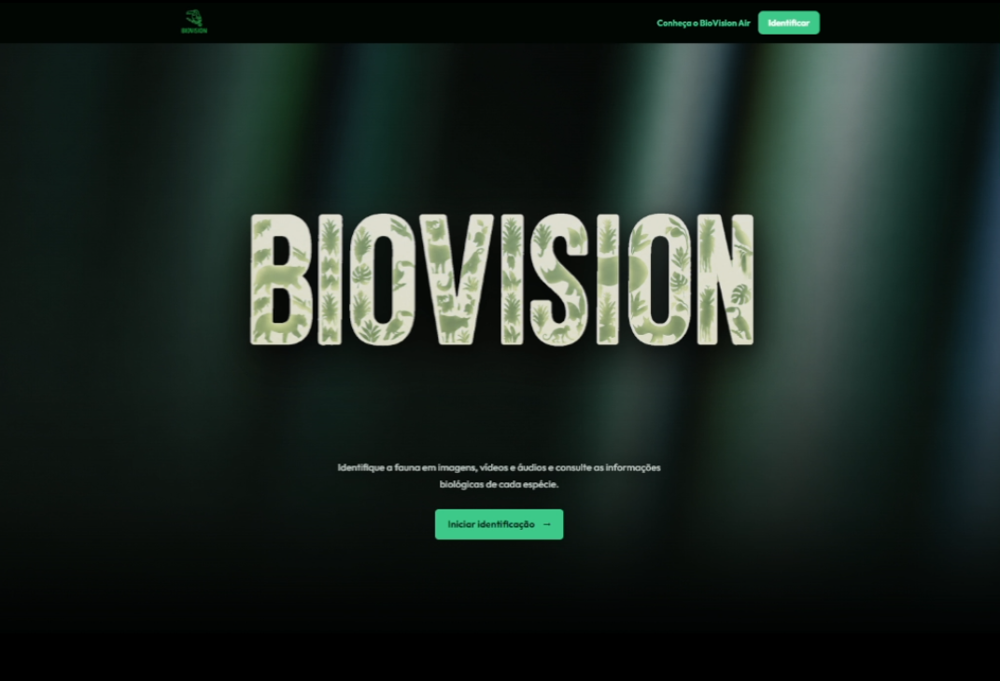

<p align="center">
  
</p>

<p align="center">
  <strong>BioVision Web</strong>
</p>

## Visão geral

O BioVision é uma plataforma Flask para apoiar a identificação de espécies da fauna por meio de imagens, vídeos e áudios, com suporte adicional para análise de vídeos aéreos no módulo BioVision Air.

## Estrutura

- `app.py`: entrada local, executada com `python app.py`.
- `backend/biovision_web/`: configuração, banco, rotas e serviços de inferência.
- `backend/data/`: índice de classes usado pelos modelos.
- `web/templates/`: páginas HTML.
- `web/static_biovision/`: CSS, JavaScript e recursos visuais.
- `models/`: modelos necessários para inferência, versionados com Git LFS.
- `database/`, `training/` e `docs/`: materiais auxiliares sem dados sensíveis.

## Execução local

Os passos abaixo são para Windows, pelo CMD. Antes de começar, instale Git, Git LFS, Python 3.14 e MySQL 8.0 ou superior. Não é necessário usar VS Code nem Apache para iniciar o site.

### 1. Baixe o projeto

Ative o Git LFS e clone o repositório na pasta em que deseja guardar o projeto.

```cmd
git lfs install
git clone https://github.com/PedroToazza/biovision-iffar.git
```

### 2. Entre na pasta

Os próximos comandos devem ser executados dentro do projeto.

```cmd
cd biovision-iffar
```

### 3. Baixe os modelos completos

O Git LFS baixa os pesos usados pela inteligência artificial. Aguarde o download terminar; os arquivos são grandes.

```cmd
git lfs pull
```

Se aparecer `invalid load key, 'v'` ao iniciar, o arquivo do modelo pode ser apenas uma referência do Git LFS. Verifique se esse download foi concluído sem erros. Uma pasta baixada por ZIP não permite executar `git lfs pull` sem um repositório Git; para este passo a passo, use o clone acima.

### 4. Crie o ambiente Python

Isso separa as dependências do BioVision das usadas por outros programas.

```cmd
py -3.14 -m venv .venv
```

Ative o ambiente no CMD.

```cmd
.venv\Scripts\activate.bat
```

### 5. Instale as dependências

Com o ambiente ativo, instale os pacotes do projeto e aguarde a conclusão.

```cmd
python -m pip install -r requirements.txt
```

### 6. Configure o banco de dados

Inicie o MySQL. Se já possui o banco do BioVision preenchido, mantenha os dados existentes e vá para a configuração do `.env`.

Para uma instalação nova, crie o banco. Nos comandos abaixo, ajuste `root` e a porta `3306` para o usuário e a porta do seu MySQL; a senha será solicitada no terminal. O comando `mysql` precisa estar disponível no PATH ou ser executado pelo caminho completo do `mysql.exe`.

```cmd
mysql -h 127.0.0.1 -P 3306 -u root -p -e "CREATE DATABASE IF NOT EXISTS biovision_especie CHARACTER SET utf8mb4;"
```

Importe o banco de teste fornecido no projeto. Faça isso somente em um banco novo ou com backup: o arquivo recria a tabela `especie`, substituindo os dados anteriores.

```cmd
mysql -h 127.0.0.1 -P 3306 -u root -p biovision_especie < database\biovision_especie-dump.sql
```

Também é possível importar pelo MySQL Workbench. O dump utiliza recursos do MySQL 8.0; o MariaDB incluído no XAMPP pode não aceitar o arquivo sem adaptações.

### 7. Configure o arquivo `.env`

Crie sua configuração local a partir do exemplo. Se o `.env` já existir, ele será preservado.

```cmd
if not exist .env copy .env.example .env
```

Abra o arquivo para preencher os dados de conexão.

```cmd
notepad .env
```

Ajuste os campos abaixo para o seu MySQL. Substitua os exemplos pelo usuário e pela senha reais; se o usuário não tiver senha, deixe o valor de `BIOVISION_DB_PASSWORD` vazio.

```dotenv
BIOVISION_DB_HOST=localhost
BIOVISION_DB_PORT=3306
BIOVISION_DB_USER=seu_usuario
BIOVISION_DB_PASSWORD=sua_senha
BIOVISION_DB_NAME=biovision_especie
```

Mantenha as outras opções do exemplo, incluindo `BIOVISION_IMAGE_BASE_URL`. Salve o arquivo. O `.env` é local e não deve ser enviado ao GitHub.

### 8. Inicie o site

Com o MySQL ligado e o ambiente Python ativo, execute o servidor. Aguarde os modelos carregarem e o endereço aparecer no terminal.

```cmd
python app.py
```

Abra [http://127.0.0.1:5001/biovision/](http://127.0.0.1:5001/biovision/) no navegador. Mantenha o terminal aberto enquanto usa o site; para encerrar, pressione `Ctrl + C`.

### Para abrir novamente

Não é necessário baixar tudo nem reinstalar as dependências a cada uso. Ligue o MySQL, abra o CMD dentro de `biovision-iffar` e ative o ambiente.

```cmd
.venv\Scripts\activate.bat
```

Depois, inicie o servidor.

```cmd
python app.py
```

As imagens biológicas são carregadas diretamente pelo navegador a partir de `BIOVISION_IMAGE_BASE_URL` (claudflare). O MySQL armazena apenas os caminhos relativos dos arquivos.

## Produção

Atualmente, o BioVision está rodando em produção na nossa instituição federal de pesquisa.

Para produção com uso reduzido de disco, o `requirements.txt` usa as distribuições oficiais CPU-only do PyTorch. Para evitar cache do `pip` e a cópia adicional dos modelos mantida pelo Git LFS, gere a imagem de produção com o `Dockerfile`:

```bash
docker build -t biovision-iffar .
docker run --env-file .env -p 5001:5001 biovision-iffar
```
